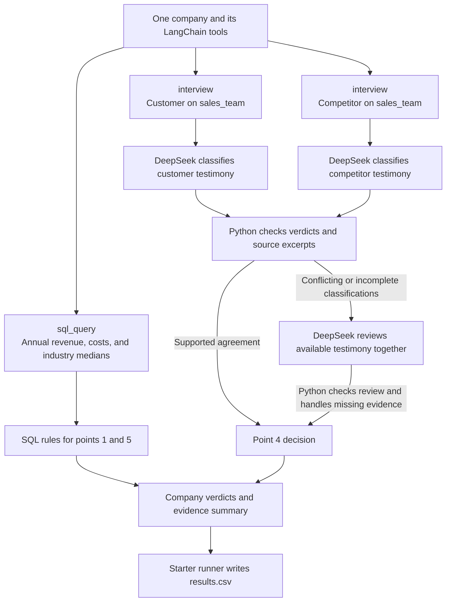

# FTEC5660 Homework 3: Fisher's 15-Point Investment Agent

Build a LangChain agent that researches a company with tools and applies the
framework from Philip Fisher's *Common Stocks and Uncommon Profits* (Part One,
Chapter 3 "What to buy: the fifteen points to look for in a common stock", and
Chapter 4 "What to buy: applying this to your own needs"). You choose 3 of
Fisher's 15 points and decide yourself what PASS means for each. For every
company your agent gives a PASS/FAIL verdict on your 3 points and a short
summary.

The companies are fictional, so the model cannot answer from memory. Unlike a
pile of reports, the evidence is spread over three sources, and your agent has
to go and get it with tools, the way Fisher's "scuttlebutt" method sends an
investor to talk to customers, competitors, suppliers and staff.

## Data and tools

`public_test/` has one folder per company. Your code receives four tools per
company (built by the provided code in `hw3.py`):

| Tool | What it gives you |
| --- | --- |
| `list_documents()` | the company's six documents and their dates |
| `read_document(name)` | one document: the 2025 letter to shareholders, four earnings calls (Q3 2025 to Q2 2026) and a news file (July 2025 to July 2026) |
| `sql_query(query)` | one read-only SQLite query on the company's database; at most 50 rows come back, so use `SUM`, `GROUP BY` and `WHERE` |
| `interview(role, topic)` | what one person says about the company; at most **10 interviews per company** |

The documents are what management says. Management's own claims (such as "we
have never cut research" or "our people are our greatest strength") are not
evidence on their own: check them against the database and the interviews.

**Database tables** (amounts in USD thousands; dates `YYYY-MM-DD`, months
`YYYY-MM`, quarters like `2025Q3`; the fiscal year is the calendar year):

| Table | Columns |
| --- | --- |
| `company` | name, industry |
| `industry_medians` | industry, revenue_growth_2y_pct, new_product_share_pct, new_product_sales_per_rd, operating_margin_pct (one row per industry; use the row for the company's own industry) |
| `orders` | order_id, order_date, product, customer, amount, note (about 3,000 to 4,000 orders from January 2023 to June 2026; revenue is the sum of order amounts) |
| `products` | product, launch_date |
| `monthly_costs` | month, cost_of_sales, selling_admin, research_development |
| `quarterly_cash` | quarter, operating_cash_flow, capex, cash_end |
| `capex_plan` | year, planned_capex (2026 to 2028) |
| `returns` | month, units_shipped, units_returned |
| `insider_trades` | trade_date, person, title, side (`buy` or `sell`), shares, price |

**Terms used in the data.**

| Term | Meaning |
| --- | --- |
| FY2025 | Fiscal year 2025. Here the fiscal year is the calendar year, so FY2025 is January to December 2025. |
| Quarter | Three months of the year: Q1 is January to March, Q2 April to June, Q3 July to September and Q4 October to December. The database writes `2025Q3`; the documents write "third quarter 2025". |
| Amounts | The database is in **USD thousands** (676,100 means US$676.1 million). The documents use USD millions. |
| Revenue | Money from sales: the sum of `amount` in `orders`. |
| Cost of sales | The cost of making the products that were sold. |
| Selling and admin | The cost of selling and of running the company (sales staff, offices, management). |
| R&D | Research and development spending, mainly on new products. |
| Operating margin | Operating profit as a share of revenue: (revenue − cost of sales − selling and admin − R&D) ÷ revenue. |
| Operating cash flow | Cash that the day-to-day business brings in during a quarter. |
| Cash at the end of a quarter | The cash the company holds on the last day of that quarter (`cash_end`). |
| Capex | Capital expenditure: spending on factories, machines and other long-term assets. `capex_plan` holds the planned capex for 2026 to 2028. |
| Return rate | Units returned ÷ units shipped, from the `returns` table. |
| Industry median | The middle value for companies in the same industry, from `industry_medians`. |
| Insider | A director or senior manager of the company. `insider_trades` lists the shares they bought (`buy`) or sold (`sell`). |
| Earnings call | A meeting each quarter where management presents the quarter's results to investors. Each call quotes that quarter's revenue. |

**Interviews.** Roles: `customer`, `current_employee`, `former_employee`,
`competitor`, `supplier`. Topics: `sales_team`, `working_conditions`,
`top_management`, `decision_making`, `competitive_edge`. Only some people know
about each topic; the others say they can't comment, and that answer still
uses up one interview.

| Topic | Who knows about it |
| --- | --- |
| `sales_team` | customer, competitor |
| `working_conditions` | current_employee, former_employee |
| `top_management` | former_employee, supplier |
| `decision_making` | supplier, customer |
| `competitive_edge` | competitor, customer |

People who know about a topic always agree with each other, so one good answer
is enough.

## Choose your 3 points and your rules

Pick any 3 of Fisher's 15 points and write them in `CHOSEN_POINTS` near the
top of `hw3.py`, e.g. `CHOSEN_POINTS = [1, 7, 15]`. The full questions are in
`FISHER_POINTS` in `hw3.py` and in the book.

| # | Fisher's point | Where the evidence is |
| --- | --- | --- |
| 1 | Market potential for sales growth | database |
| 2 | New products as current lines mature | database |
| 3 | Effective research and development | database |
| 4 | Above-average sales organization | interviews (`sales_team`) |
| 5 | Worthwhile profit margin | database |
| 6 | Maintaining or improving margins | database |
| 7 | Labour and personnel relations | interviews (`working_conditions`) |
| 8 | Executive relations | interviews (`top_management`) |
| 9 | Depth of management | interviews (`decision_making`) |
| 10 | Cost analysis and accounting controls | earnings calls, checked against the database |
| 11 | Advantage over competitors | interviews (`competitive_edge`) |
| 12 | Long-range outlook on profits | database |
| 13 | Growth without dilutive equity financing | database |
| 14 | Management talks freely about troubles | earnings calls, checked against the database |
| 15 | Management of unquestionable integrity | news file, checked against the database |

For each of your points, **you design the rule**: which evidence to use, what
to compute or whom to ask, and where the line between PASS and FAIL lies. PASS
means the company looks favourable on that point, as Fisher would see it.

We grade your verdicts against our own answer key. It uses one fixed rule per
point, which we do not publish, and the data never puts a company close to
the line of that rule, so a sensible reading of Fisher usually gives the same
answer. **Test your rules on the public answers**:
`public_test/ground_truth.json` gives the expected verdict on all 15 points
for each of the 20 public companies, and every point fails in 6 of them. If
your rule disagrees with the public answers, rethink it.

**Tip: calculate with tools, not in your head.** Do every sum, ratio and
comparison in SQL or Python, including the number of days between two dates
(SQLite's `julianday()` gives a date as a number of days).

## Student task

Fill in the three places in `hw3.py` marked `### YOUR CODE HERE`. You may add
imports, constants and helper functions above them, but do not change the
provided code below them:

- `CHOSEN_POINTS` lists your 3 points.
- `build_agent()` creates your model and anything else you need once.
- `analyze_companies(agent, companies)` receives
  `{company_folder: [list_documents, read_document, sql_query, interview]}`
  and returns, for every company,
  `{"points": {1: "PASS", 7: "FAIL", 15: "PASS"}, "summary": "..."}` (here with
  `CHOSEN_POINTS = [1, 7, 15]`).

Use the course techniques that fit your points: tool use for the database and
the interviews, planning which interviews to spend, routing each point to the
right source, prompt chaining, parallel calls, reflection to check your
answers, or a combination. Your code must read company data **only through
the four tools**; do not open `company.db` or `interviews.dat` yourself. Do
not hard-code folder names, company names or the public answers.

## Setup and public test

```bash
python3 -m venv .venv
source .venv/bin/activate
pip install -r requirements.txt
echo "DEEPSEEK_API_KEY=your_key_here" > .env
python3 hw3.py --data-folder public_test
```

Use your own DeepSeek API key (from https://platform.deepseek.com). The
required model is `deepseek-v4-flash`. We grade with our own key, so never put
a key in your code; `.env` must stay out of git.

The program creates `results.csv` with the columns `company`, `points`,
`points_correct`, `point_errors`, `interviews_used` and `summary`, and prints
the point score on your 3 points (the percentage after "balanced"). The point
score is the average of two shares: the share of truly passing verdicts that
you marked PASS and the share of truly failing verdicts that you marked FAIL.
For example, 90% and 60% give (90% + 60%) / 2 = 75%, and marking every point
PASS gives (100% + 0%) / 2 = 50%. Once `CHOSEN_POINTS` is set, the starter
runs before you add any API code (it returns no verdicts, so it scores 0%).

`public_test/ground_truth.json` gives the expected verdicts on all 15 points
for each public company. Grading uses a private set of about 20 unseen
companies with the same tools and the same answer key rules, but different
names and wording, and scores your 3 points only.

## Homework 3 solution

### My three points and rules

I chose points **1, 4, and 5** to examine three aspects of a growth company:
its sales growth, the quality of its sales organization, and how much operating
profit it earns from its revenue.

#### Point 1 · Market potential for sales growth

I chose this point because a multiyear sales record gives a starting point for
assessing growth potential. Fisher observes that even exceptional companies
can grow in uneven spurts and recommends looking at “units of several years
each.” (Fisher, Part One, Chapter 3, pp. 47–53.)

**PASS rule.** Cumulative revenue growth from FY2023 to FY2025 must be positive
and strictly greater than the company's own industry median for two-year
revenue growth.

**Evidence.** The SQL tool sums `orders.amount` for the two complete fiscal
years, calculates `100 × (FY2025 revenue − FY2023 revenue) / FY2023 revenue`,
and retrieves `revenue_growth_2y_pct` for the industry identified in `company`.
Historical growth is a proxy for the forward-looking potential Fisher asks about.

#### Point 4 · Above-average sales organization

I chose this point because customers and competitors can describe how reps
actually help buyers evaluate and use a product. Fisher identifies “repeat
sales to satisfied customers” as an early sign of success and recommends
asking both groups about the sales organization. (Fisher, Part One, Chapter 3,
pp. 59–62.)

**PASS rule.** Interview testimony must describe a material sales or distribution
strength, such as skilled application advice, useful proactive follow-up, or
service that earns customer preference. Concrete evidence of ordinary or weak
support yields FAIL, while vague, unrelated, or unresolved evidence leaves the
verdict missing.

**Evidence.** The agent calls `interview` with topic `sales_team` for a customer
and a competitor. It validates each cited excerpt against the corresponding
transcript and considers who provided the support, when it happened, and how
it affected the buyer's decision.

#### Point 5 · Worthwhile profit margin

I chose this point because rising sales matter to investors when they lead to
operating profit. Fisher compares margins among companies in the same industry
and looks across years because an unusually strong year can temporarily lift
the margins of weaker firms. (Fisher, Part One, Chapter 3, pp. 62–63.)

**PASS rule.** The FY2025 operating margin must be positive and at least as high
as the company's industry median operating margin.

**Evidence.** The SQL tool sums order revenue and monthly cost of sales,
selling and administrative expenses, and R&D separately. It subtracts those
costs from revenue, divides by revenue, and compares the percentage with
`industry_medians.operating_margin_pct` for the company's industry. The verdict
uses FY2025, the latest complete fiscal year, and the summary includes FY2023
and FY2024 margins where available to show the historical context.

### Agent design



The agent routes points 1 and 5 to one read-only SQL query that performs the
arithmetic and comparisons. For point 4, it runs the two interview
classifications independently and in parallel with the same LangChain
`deepseek-v4-flash` model. Python checks that the cited text appears in the
right transcript. If classifications disagree or a retrieved interview yields
an unusable classification, a review call reads the available testimony
together. An explicitly inconclusive review leaves point 4 missing. If the
review request fails, the agent can still use an unopposed supported
classification. Python assembles the verdicts and evidence into a short
summary and preserves available results when another branch fails.

### Public test results

Run `python3 hw3.py --data-folder public_test` from the repository root.
All three runs of the final version returned **60/60 correct verdicts** on 20
companies, with a **balanced point score of 100.0%**. The runner computes
that score as the mean of the accuracy on expected PASS and expected FAIL
verdicts.

| Fisher point | Expected PASS predicted correctly | Expected FAIL predicted correctly | Total correct |
| --- | ---: | ---: | ---: |
| 1 · Sales growth potential | 14/14 | 6/6 | 20/20 |
| 4 · Sales organization | 14/14 | 6/6 | 20/20 |
| 5 · Profit margin | 14/14 | 6/6 | 20/20 |
| **All three points** | **42/42** | **18/18** | **60/60** |

**Disagreements.** Every company matched all three public labels. For example,
`hollins_group` passed point 1 with 19.29% revenue growth against a 16.20%
industry median and passed point 5 with a 20.46% operating margin against a
16.80% median. It failed point 4 because a customer reported receiving a price
list from the sales team and relying on competitors for advice.

The agent used two interviews per company, within the limit of ten. These
results describe performance on the supplied public set.

**Reference.** Philip A. Fisher, *Common Stocks and Uncommon Profits and Other
Writings*, Part One, Chapters 3 and 4.

## Task 2: Reflection

Imagine asking the Fisher agent, “This company clearly has a strong sales team.
Can you confirm?” If the interview evidence stays the same, “I think their
sales team is weak” should lead to the same verdict. I understand AI
sycophancy as a failure of that test. The model gives the user's stated view
more weight than the evidence warrants. Sharma et al. found that responses
matching users' views were more likely to be preferred in the human-feedback
data they analyzed. That helps explain why a model trained to give responses
people like can learn to agree too readily.
[Sharma et al., *Towards Understanding Sycophancy in Language Models*](https://arxiv.org/abs/2310.13548)

In a synthetic test for point 4, an early version returned PASS after a
competitor said buyers came to **its** team for advice because the company
being evaluated only supplied quotes. The excerpt was genuine, and the agent
gave credit to the wrong team. This source-attribution error showed me how
easily a plausible explanation can make a weak conclusion feel settled. The
revised agent uses fixed criteria, reads the two accounts independently, and
revisits the original testimony when the interpretations conflict. It can leave
a verdict missing if the evidence stays inconclusive. Both readings use the
same model, so they can still share the same blind spot.

The term “AI psychosis” in the assignment is an informal label. My concern is
how a chatbot may reinforce a person's delusional beliefs over a long
conversation. A model can echo a user's interpretation, elaborate on it, and
carry those elaborations into later replies. Its earlier guesses may then feel
like independent confirmation to the user. Moore et al. observed patterns such
as chatbot affirmation and endorsement of implausible beliefs in chat logs
from people who reported harm. Those selected cases document what happened in
the conversations. The frequency of these outcomes and the chatbot's causal
role remain open questions.
[Moore et al., *Characterizing Delusional Spirals through Human-LLM Chat Logs*](https://spirals.stanford.edu/assets/pdf/moore_characterizing_2026.pdf)

In a sensitive conversation, I would want an assistant to acknowledge the
person's distress and stay careful about the explanation. If someone feels that
a coincidence contains a message meant for them, a response can recognize how
unsettling it felt, ask what they directly observed, and leave the interpretation
open. If the belief is causing distress or affecting important decisions, the
assistant can encourage a conversation with a trusted person or a qualified
professional. As a developer, I would test this over several turns, including
whether the assistant becomes more certain merely because the user asks it to
confirm the same claim again. For the Fisher agent, I would run the parallel
test with bullish and bearish framings of the same evidence. In both settings,
I would check whether the assistant holds a supported conclusion under repeated
pressure and can revise it when new evidence appears.
